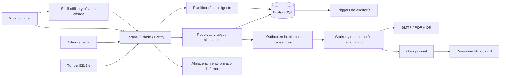
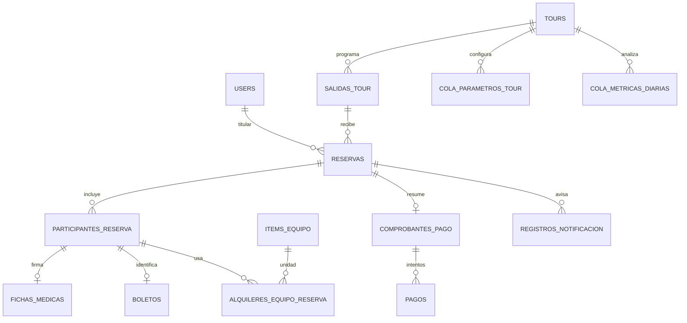
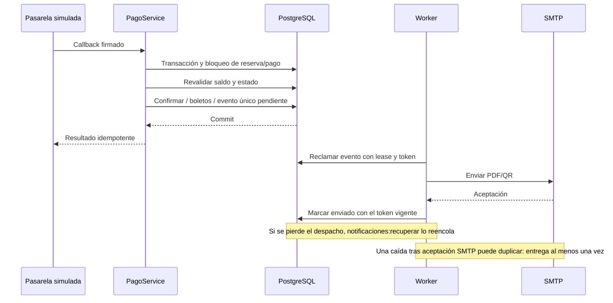

# Arquitectura verificada de la entrega

14/11/2026 UTC. Complementa el [diccionario físico](DICCIONARIO-ACTUAL.md) y el [plan](../Plan_Trabajo_Agencia_Turismo.md). Los diagramas describen el código del repositorio; no acreditan que los servicios externos estén configurados.

## Pago y aviso recuperable

El lease dura cinco minutos; un evento ya enviado se omite. Los fallos conservan el evento con backoff y un máximo de diez intentos automáticos. El panel permite revisar/reintentar. Los eventos de confirmación y pago parcial se crean antes del commit del pago; el envío sucede después. No se añade una devolución bancaria donde solo existe un estado de simulación.

## Concurrencia e IO

- Reserva: bloqueo de la salida y de los ítems en orden, seguido de revalidación de cupos/stock. Pago y cancelación bloquean la reserva antes de modificar sus efectos.
- Programación/asignación/revisión: transacción y bloqueo de agenda PostgreSQL; se relee la salida/propuesta antes de validar. Una página antigua no puede volver a aplicar o rechazar una propuesta revisada.
- Parámetros: bloqueo del tour y un índice parcial UNIQUE impiden dos configuraciones activas. Las métricas nuevas conservan JSON `contexto` con versión, período, fuente, λ/μ/c/K y costos. Recalcular una fecha actualiza expresamente su fila y deja la escritura auditada; no recupera el contexto de filas antiguas sin ese campo.
- Markov: transiciones entre cierres de meses completos, matriz redondeada que conserva suma de fila y estados absorbentes. Cohortes basadas en el primer evento registrado; no se fabrican fechas históricas desconocidas.
- EOQ: D cuenta usos del año calendario; σ procede de los días del mismo año, incluidos ceros. Q/R son referencias académicas. Una compra de equipo reutilizable necesita un modelo económico de desgaste aprobado.

## Offline

El service worker almacena solo HTML/JS estáticos genéricos. IndexedDB conserva AES-GCM, con clave derivada mediante PBKDF2-SHA256 (250.000 iteraciones y sal aleatoria); la clave no se persiste. La bóveda identifica sesión/usuario y cada salida vence a las doce horas. Web Locks impide dos escritores simultáneos. Se bloquea y limpia ante logout/cambio de cuenta; la sincronización vuelve a comprobar cuenta/sesión, asignación y estado del boleto en el servidor. La copia offline puede quedar desactualizada durante su vigencia y el resultado definitivo se conoce al sincronizar; los conflictos permanecen visibles.

La copia se limita a nombres, códigos, estado y equipo. Documentos y condiciones médicas quedan fuera. El cifrado no sustituye la protección del teléfono mientras la pantalla está desbloqueada.
